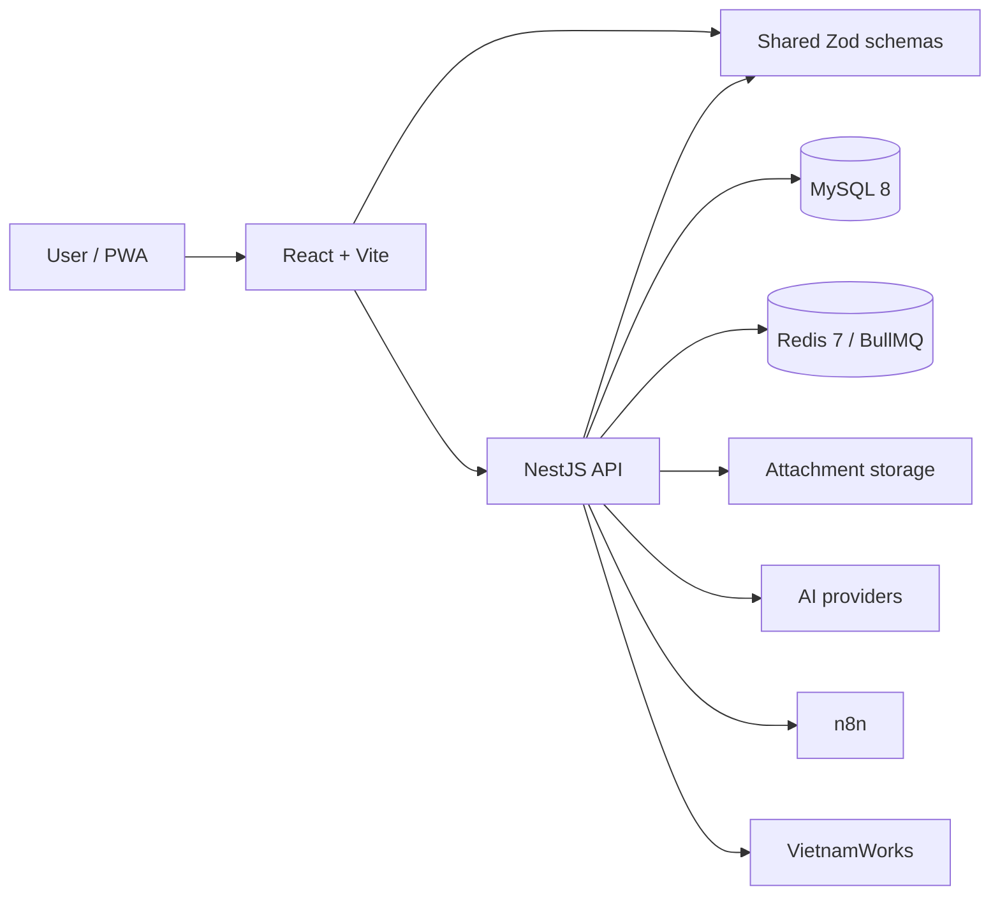

# Smart Assistant

Smart Assistant là một PWA tự host để quản lý kiến thức cá nhân, theo dõi cơ hội việc làm và kết nối các workflow tự động. Ứng dụng tập trung vào ba nhóm chức năng:

- **Notes & AI Assistant:** tổ chức ghi chú và dùng dữ liệu ghi chú làm context cho trợ lý AI.
- **Job Tracking & Evaluation:** tiếp nhận, chuẩn hóa và đánh giá thông tin việc làm theo hồ sơ phù hợp.
- **Workflow Automation:** kết nối với n8n để thu thập dữ liệu và theo dõi trạng thái workflow.

## Features

### Notes & AI Assistant

- Tổ chức ghi chú theo notebooks và tags.
- Soạn thảo nội dung rich text với TipTap.
- Tìm kiếm full-text, kèm `LIKE` fallback cho truy vấn ngắn hoặc một phần.
- Đính kèm file vào ghi chú.
- Liên kết giữa các ghi chú thông qua references/backlinks.
- Trợ lý AI hỗ trợ nhiều provider, hội thoại streaming qua SSE và tool calls.
- Tool calls có thể đọc dữ liệu hoặc chờ người dùng xác nhận trước khi tạo dữ liệu.

### Job Tracking & Evaluation

- Nhận dữ liệu job từ workflow bên ngoài qua API.
- Upsert theo `jobId` để tránh tạo bản ghi trùng.
- Chuẩn hóa technology stack thành các technology dùng chung.
- Tìm kiếm, lọc và phân trang danh sách job.
- Đánh giá mức độ phù hợp theo skills, mức lương, cấp bậc, hình thức làm việc và career preferences.
- Hiển thị điểm phù hợp cùng breakdown theo từng tiêu chí.
- Hỗ trợ đồng bộ job theo lịch từ VietnamWorks bằng BullMQ và Redis.

### Workflow Automation

- Kết nối với một instance n8n do người dùng cấu hình.
- Theo dõi các workflow executions từ trong ứng dụng.
- Xem danh sách, chi tiết, trạng thái và lỗi của execution.
- Dừng, chạy lại hoặc xóa execution.
- Chuẩn hóa dữ liệu từ n8n thành DTO ổn định trước khi trả về frontend.
- Lưu n8n API key được mã hóa trong user settings; credential không được trả về frontend.

## Data flow

### Notes and AI Assistant

```text
User creates or searches notes
        ↓
Notes API validates and stores content in MySQL
        ↓
AI Assistant receives a conversation message
        ↓
AI provider or local fallback processes the request
        ↓
Assistant can read selected domain data through validated tools
        ↓
Response and tool events are sent to the frontend through SSE
```

### Job tracking

```text
External workflow / n8n
        ↓
POST /api/jobs
        ↓
Validate and normalize job payload
        ↓
Upsert job and technologies in a transaction
        ↓
Search, filter, paginate and score jobs
        ↓
Display matching results in the Jobs page
```

### Workflow automation

```text
n8n instance
        ↓
Backend proxy with per-user API key
        ↓
Normalize execution data
        ↓
Shared Zod response schema
        ↓
Jobs workflow drawer
```

## Architecture



The repository is organized as a pnpm workspace:

```text
smart-assistant/
├── apps/
│   ├── backend/        # NestJS API, business modules and workers
│   └── frontend/       # React + Vite PWA
├── packages/
│   └── shared/         # Zod schemas and shared TypeScript types
├── docs/               # Architecture, module and setup documentation
├── docker-compose.yml  # Local MySQL and Redis
└── pnpm-workspace.yaml
```

The main request path is:

```text
Frontend page
  → apps/frontend/src/lib/api.ts
  → NestJS controller
  → Zod validation
  → Domain service
  → TypeORM repository / external integration
  → Shared response schema
  → Frontend
```

Schemas in `packages/shared` are used as the contract boundary. The backend validates incoming data, while the frontend parses API responses to detect contract drift.

## Main technologies

| Area | Technologies |
|---|---|
| Frontend | React 18, Vite, TypeScript, Tailwind CSS, shadcn/ui, TanStack Query, TanStack Router, TipTap |
| Backend | NestJS 10, TypeORM 0.3, TypeScript, Pino |
| Data | MySQL 8, Redis 7 |
| Background jobs | BullMQ |
| Contracts | Zod schemas in `packages/shared` |
| AI | Claude, OpenAI, Ollama, local rule-based fallback |
| Automation | n8n API, email/workflow integrations configured outside the app |
| Deployment | Docker Compose, Nginx and Certbot |

## Documentation

- [Setup guide](./docs/setup.md) — local development and deployment configuration.
- [Architecture index](./docs/architecture.md) — overview of modules, integrations and infrastructure.
- [Notes module](./docs/modules/notes/README.md) — notebooks, tags, search, attachments and sharing.
- [AI module](./docs/modules/ai/README.md) — conversations, SSE events, providers and tool calls.
- [Jobs module](./docs/modules/jobs/README.md) — job ingestion, normalization, search and matching.
- [Job sync module](./docs/modules/job-sync/README.md) — scheduled job synchronization with BullMQ.
- [n8n integration](./docs/platforms/n8n/README.md) — workflow execution proxy and configuration.
- [Full requirements](./docs/SRS.md) — product requirements and planned scope.

## Prerequisites

- Node.js `>= 20.11`
- pnpm `>= 9` — the repository uses pnpm `9.12.3`
- Docker and Docker Compose
- WSL 2 with Ubuntu is recommended for local development on Windows

## Quick start

Run the commands from the repository root. On Windows, run pnpm and Node commands inside WSL.

```bash
# 1. Install dependencies
pnpm install

# 2. Configure environment variables
cp .env.example .env
# Set the required secrets described in .env.example

# 3. Start MySQL and Redis
pnpm docker:up

# 4. Build the backend so compiled migrations are available
pnpm --filter @assistant/backend build

# 5. Run database migrations
pnpm --filter @assistant/backend migration:run

# 6. Start the shared package, backend and frontend
pnpm dev
```

Default local endpoints:

- Frontend: `http://localhost:5173`
- Backend API: `http://localhost:3000/api`
- Health check: `http://localhost:3000/api/health`

Useful commands:

```bash
pnpm typecheck
pnpm lint
pnpm test
pnpm build
pnpm docker:down
```

## n8n configuration

The n8n integration is optional. When configured, the backend uses the n8n API to read and manage workflow executions.

Configure the n8n base URL and API key in the application's user settings. The API key is encrypted before storage and is only decrypted server-side when making requests to n8n.

Job ingestion workflows can send normalized job payloads to the public job ingestion endpoint. The backend then validates the payload, normalizes technologies and upserts the job data. The repository also includes a BullMQ-based scheduled synchronization flow for VietnamWorks.

The exact workflow design remains configurable in n8n, so the application can be connected to email, job sources or other external services without placing those provider-specific workflows inside the frontend.

## Project status

The core flows for notes, AI conversations, job tracking, job matching and n8n execution management are implemented. See the module documentation for the current behavior and operational details of each area.
