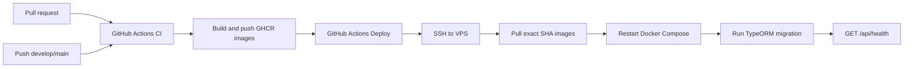

> **Status:** Draft — generated from code survey on 2026-10-20
> **Last updated:** 2026-10-20
> **Owners:** TODO: confirm (team/person)

# CI/CD

GitHub Actions tự động kiểm tra chất lượng code và deploy ứng dụng lên VPS qua SSH. Luồng `develop` dùng GitHub Environment `staging`; luồng `main` dùng `production` với protection rule/approval riêng.

## Document Map

- Root rules → `../../../CLAUDE.md`
- Architecture index → `../../architecture.md`
- Deployment runbook → `../../setup.md`
- Backend architecture → `../../architecture/backend.md`
- Security architecture → `../../architecture/security.md`

## Module Purpose

- Chạy lint, typecheck, test và build trên pull request/push.
- Chỉ deploy sau khi workflow CI hoàn tất thành công trên branch `develop` hoặc `main`.
- Build và push backend/frontend images lên private GHCR theo commit SHA.
- Deploy đúng images đã kiểm tra lên VPS qua SSH, không build lại trên VPS.
- Chạy TypeORM migration và health check sau khi pull image.
- Kiểm tra health endpoint sau deploy.
- Không quản lý secret ứng dụng; `.env.production` phải tồn tại sẵn trên server.

## Primary Entrypoints

| Layer | Entrypoint | Purpose |
|-------|-----------|---------|
| CI workflow | `.github/workflows/ci.yml` | Quality gates và build/push GHCR images cho branch `develop`/`main`. |
| Deploy workflow | `.github/workflows/deploy.yml` | SSH pull image, migrate và health check cho staging/production. |
| Package scripts | `package.json` | Các lệnh `lint`, `typecheck`, `test`, `build`, `prod:*`. |
| Production compose | `docker-compose.prod.yml` | Redis/backend/frontend và healthcheck backend. |

## Core Supporting Objects

- `apps/backend/Dockerfile`: build image backend production.
- `apps/frontend/Dockerfile`: build image frontend production.
- `docs/setup.md`: prerequisite VPS, env, migration, health check và vận hành.

## Data Flow

## When To Touch Which File

| If you want to… | Edit | Then also… |
|-----------------|------|------------|
| Đổi quality gate | `.github/workflows/ci.yml` | Chạy lại các script trong `package.json`. |
| Đổi deploy command | `.github/workflows/deploy.yml` | Cập nhật `docs/setup.md` và kiểm tra VPS runbook. |
| Đổi production topology | `docker-compose.prod.yml` | Cập nhật `docs/setup.md` và workflow health/migration. |
| Thêm secret deploy | GitHub Environment secrets | Không commit secret; cập nhật bảng secret trong doc này. |

## Permission & Access Rules

- Quality workflow chỉ có `contents: read`; job publish images có thêm `packages: write`.
- GHCR images dùng tag commit SHA: `ghcr.io/<owner>/<repo>/backend:<sha>` và `frontend:<sha>`.
- SSH key, host, port, user, path, known hosts, registry username/token và health URL nằm trong GitHub Environment secrets.
- Không dùng `StrictHostKeyChecking=no`; `DEPLOY_KNOWN_HOSTS` phải chứa host key đã xác minh.
- Production nên bật required reviewers và branch protection trong GitHub Environment.
- Deploy user trên VPS chỉ được cấp quyền cần thiết cho repo, Docker và pnpm.

## Legacy / Operational Notes

- Tạo hai GitHub Environments: `staging` và `production`. Mỗi environment cần các secrets `DEPLOY_HOST`, `DEPLOY_PORT`, `DEPLOY_USER`, `DEPLOY_PATH`, `DEPLOY_SSH_KEY`, `DEPLOY_KNOWN_HOSTS`, `DEPLOY_HEALTHCHECK_URL`.
- `DEPLOY_PATH` là thư mục chứa `docker-compose.prod.yml` trên VPS; file `.env.production` phải được tạo thủ công trên server và không được workflow ghi đè.
- VPS cần Docker Compose và quyền pull private GHCR images; workflow đăng nhập registry bằng `--password-stdin`, pull image theo commit SHA, restart services, chạy migration trong backend container và health check.
- `docker-compose.prod.yml` dùng `BACKEND_IMAGE` và `FRONTEND_IMAGE`; `docker-compose.yml` local vẫn giữ build từ source.
- Migration cần backward-compatible. Khi deploy lỗi, giữ stack cũ nếu compose chưa thay đổi; rollback bằng cách checkout commit/tag trước đó trên server rồi build/up lại và đánh giá migration trước khi revert.
- GitHub Actions dùng action nội bộ `actions/checkout`, `actions/setup-node`, `pnpm/action-setup` trong CI; deploy dùng native OpenSSH để hạn chế credential-handling bên thứ ba.

## Where To Start Reading For Maintenance

1. `.github/workflows/ci.yml`
2. `.github/workflows/deploy.yml`
3. `package.json`
4. `docker-compose.prod.yml`
5. `docs/setup.md`

## Related Modules

- Database & migrations → `../database-migrations/README.md` — migration được chạy sau khi stack khởi động.
- Crypto & secret storage → `../crypto-secrets/README.md` — secret ứng dụng không đi qua workflow.

## Document History

| Date | Change | Author |
|------|--------|--------|
| 2026-10-20 | Document CI/CD workflows, environments, secrets and VPS operations | Claude Code |
| 2026-10-21 | Document GHCR image build, push and pull deployment flow | Claude Code |
